<p align="center"></p>

<h1 align="center">cockpit</h1>

<p align="center"><b>One space with everything, for Claude Code users who switch context all day.</b><br>
A Claude Code plugin and a <a href="https://herdr.dev">herdr</a> plugin that work as one.</p>


herdr runs your agents side by side but doesn't know what they work on. cockpit adds that context:

- each agent sits beside its **ticket, PR, CI, deploy** and the page it tests;
- pinned spaces hold your **inbox, runbooks, to-dos, meetings, releases and routines**;
- **one palette** searches all of it, the week's history and your past sessions.

## Install

In a Claude Code session inside herdr:

```
/plugin install cockpit --marketplace quaresc/cockpit
/cockpit:setup
```

Setup installs the herdr half for your machine, asks which features you want and writes your config.
`/cockpit:doctor` checks everything and says how to fix it. Updates arrive as a notification.

**Needs** macOS (Linux untested), herdr 0.9+, `gh` signed in, `jq`, Xcode command line tools and a Nerd Font.

## Features

### Beside each agent

**🧭 Sidebar** · Each agent's task, branch, ticket, CI and page, plus counts on the pinned spaces. Turns red on failing
CI or when two agents share a branch.

<p align="center"></p>

**🔗 Footer** · One click to the ticket, PR, deploy dashboard, preview and every page the conversation cites.

<p align="center"></p>

**🧪 E2E tests** · The agent opens its page in terminal-browser beside it, phone then desktop, main against the branch,
and puts the before/after in the PR.

<p align="center"></p>

**📊 Show** · A pane beside the agent for charts, tables, diagrams, pictures, before/after compares, live Metabase or
Datadog data, questions, and diffs you comment line by line.

<p align="center"></p>

**🔔 Notifications** · Each with buttons that act: Review, Why?, Rerun, Plan, Join.

<p align="center"></p>

**☀️ Briefs** · A morning brief, meeting briefs, a recap when you come back to a space, a check after each deploy.

<p align="center"></p>

### Pinned spaces

**📥 Inbox** · Review requests, then your tickets by project with their stacked PRs, CI, deploys, previews and Claude
usage cost.

- Every row has its actions; pick several rows to act on them at once. `/` filters.
- Review threads and failing CI show beside a PR.
- A row flashes when its CI turns or an agent finishes, and is marked when it changed since your last visit.
- Reviews, plans and talks about a ticket (forked from the session that worked on it) open in the actions space.

<p align="center"></p>

**📋 Runbook** · `/runbook` writes the steps left to ship a ticket and keeps them current. Steps light up as they get
done; filter, edit and add them in place.

<p align="center"></p>

**📝 To-do** · A Markdown list you edit in place, ticket keys and links clickable. `/todo <text>` adds to it from any
session.

<p align="center"></p>

**📅 Meetings** · Your week as a list or day by day, with join and prepare on each meeting.

<p align="center"></p>

**🩺 Monitor** (opt-in: add `monitor` to `spaces`) · Every new release of the environment, judged once it has run a
while: errors, p95 and new Datadog errors before and after, alerting monitors, a day of numbers per app. From a release or an error, investigate,
fix it in a draft PR, file a bug or roll back.

<p align="center"></p>

**⏰ Routines** (opt-in: add `routines` to `spaces`) · Claude prompts and scripts the hub runs on its own: on a schedule
(`weekdays 09:00`, `every 30m`, cron), or when something happens (`on ci-failed`, `on review`, `on release-moved`). Each
run's answer, estimated cost and session stay with it, and a weekly budget can cap a routine; run, stop, pause, edit or
talk a run over from the space. `a` adds one,
`/routine <when and what>` asks Claude to write it. Local: they run while the hub does.

<p align="center"></p>

### Everywhere

**🔎 Palette** · `prefix+space` (or Cmd+K in Ghostty) over any pane, ctrl+p in every app. Finds tickets, PRs, runbook
steps, meetings, releases, the week's history and past sessions, by what was said or what they were about ("the session
where we fixed quotas"). Over a Claude session, put what you found in its prompt, ask it about it or fork it. Claude
searches the same way.

<p align="center"></p>

**⚙️ Settings** · `/cockpit` flips what you change day to day.

<p align="center"></p>

## Supported tools

**Built in**: works out of the box. **Mapped by setup**: `/cockpit:setup` maps that connector's tools, so it works as
far as they go.

| Area | Built in | Mapped by setup |
| --- | --- | --- |
| Code, PRs and reviews | GitHub | |
| Tickets | Linear | Jira, Trello, Asana, ClickUp, Shortcut, GitHub Issues, GitLab Issues, Azure DevOps Boards |
| CI | GitHub Actions, CircleCI, any GitHub check on your PRs | GitLab CI, Buildkite, Jenkins |
| Calendar | Google Calendar | Outlook |
| Deploys and previews | | Argo CD, Vercel, Netlify, Render, Railway, Fly.io, Backstage |
| Live data in show panes | Metabase, Datadog | |
| Check after a deploy | Datadog | Grafana, Sentry |
| Meeting briefs read | Notion | Confluence, Google Docs |
| E2E browser | terminal-browser, Claude in Chrome | |
| Line comments on a diff | herdr-reviewr | |

<details>
<summary><b>Footer links</b>, one chip each</summary>

| | |
| --- | --- |
| Code review | GitHub, GitLab, Bitbucket, Azure DevOps |
| Tickets | Linear, Jira, GitHub, GitLab, Azure DevOps, Trello, Asana, ClickUp, Shortcut |
| Design | Figma (design, FigJam, Slides, Make), Miro, Excalidraw |
| Docs | Notion, Confluence, Google Docs, Sheets, Slides and Forms, Coda, Loom |
| Chat | Slack, Microsoft Teams, Discord |
| Monitoring | Sentry, Datadog, Grafana, PagerDuty, incident.io |
| Analytics | Amplitude, Mixpanel, PostHog, Metabase |
| Deploys | Argo CD, Vercel, Netlify, Render, Railway, Fly.io, your preview environments |

</details>

## Configuration

`~/.config/cockpit/config.json`, written by `/cockpit:setup`, re-read every 30 seconds. See
[`config.example.json`](config.example.json).

The hub fetches GitHub every minute with `gh`'s token (or `GH_TOKEN`), so PRs and checks stay fresh without a Claude
session. Everything else comes through a session's connectors, unless you give the hub a token below.

<details>
<summary><b>Keys</b></summary>

| Key | |
| --- | --- |
| `reposDir` | Where your checkouts live; new agent spaces start there. |
| `github.org` | Only list your PRs from this org. |
| `tickets` | Ticket connector: `server`, `keys` (prefixes such as `ENG`), `urlTemplate`, and the mapping for anything but Linear. |
| `tickets.token` | Optional Linear API key (Settings → Security & access): the hub fetches tickets itself. |
| `ci` | GitHub checks when `server` is empty, else a CI connector and its mapping. `imageJob`: the job that builds a preview's image. |
| `ci.token` | Optional CircleCI personal API token: the hub fetches runs itself. |
| `calendar` | Google Calendar, or another connector and its mapping. |
| `platform` | Deploy and preview connector, and its mapping. |
| `metabase`, `datadog` | Connectors for live panes; Datadog also feeds the monitor. |
| `monitor` | `env`; the Datadog `queries` per service (`errors`, `hits`, `p95`, with `{service}` and `{env}`); when a release counts as `moved` (`errorPoints`, `p95Ratio`, `p95Ms`, `minHits`); whose releases `notify` (`mine`, `all`, `none`). |
| `brief`, `meetingBrief`, `recap`, `deployWatch` | When they run and which tools they may use. |
| `e2eBrowser` | `terminal-browser` (beside the agent) or `chrome` (Claude in Chrome). |
| `spaces` | Pinned spaces in sidebar order: `inbox`, `terminal`, `actions` (a tab per review, plan or talk started from the inbox or runbook), `to-do`, `runbook`, `meetings`, the opt-in `monitor` and `routines`, and your own, as a name or `{ "name": "notes", "cwd": "~/notes", "icon": "", "key": "prefix+n" }`. An open space with that name becomes the pinned one. |
| `density` | `comfortable` (default, actions in a panel under the list) or `compact` (buttons on the row). `/cockpit` switches it. |

Tokens stay in this file only.

</details>

<details>
<summary><b>Shortcuts</b></summary>

| Keys | |
| --- | --- |
| `prefix` + `i` `t` `a` `d` `u` `m` `o` `y` | Inbox, terminal, actions, to-do, runbook, meetings, monitor, routines (and each own space's `key`) |
| `prefix+f` | The page beside the agent, in your browser |
| `prefix+space` | The palette, over any pane |
| `j` `k` · `g` `G` · `[` `]` | Rows · ends · groups, in every app |
| Enter · `o` · `/` · `v` · `R` | Main action · open · filter · pick · refresh |
| ctrl+p | The palette, from inside an app |

In the palette, Enter goes to what it found. Over a Claude session, `ctrl+r` types its reference at the prompt (a PR's
URL, a ticket and its URL, a release and its verdict), `ctrl+a` asks the session about it, `ctrl+f` forks the session
into the actions space to look into it. It also jumps to a pinned space, refreshes the inbox and shows the doctor's
report or today's brief.

**Cmd+K in Ghostty**: make the key type herdr's prefix then a space. With the default ctrl+b, in
`~/.config/ghostty/config`:

```
keybind = cmd+k=text:\x02\x20
```

For another prefix, ctrl+<letter> is the letter's alphabet position in hex (ctrl+a `\x01`, ctrl+s `\x13`), F12 is
`\x1b[24~`. This replaces Ghostty's clear screen.

</details>

## How it works

- `plugin/`, the Claude Code half, fetches from your sessions' connectors, one session at a time, and hands the result to
  the hub.
- `herdr/`, the herdr half, is one `cockpit` binary: the space apps and the hub.
- The hub is the only writer. It keeps the data and a week of history in `~/.cache/cockpit/store.redb` (mirrored as
  JSON), pushes each change to the apps, and queues their button presses for the next session to carry out.

The screenshots are the real apps on made-up data; [`docs/screenshots`](docs/screenshots) regenerates them.

## License

MIT
