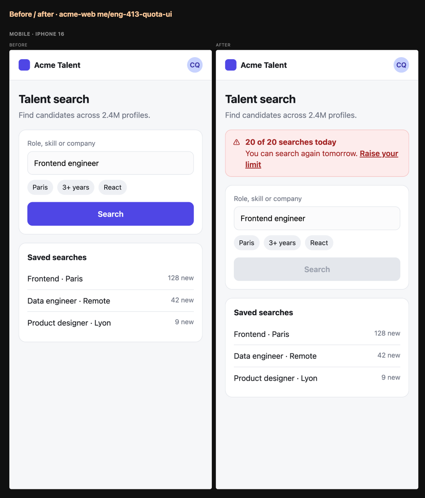

<p align="center"></p>

<h1 align="center">cockpit</h1>

<p align="center"><b>Run several Claude Code agents in <a href="https://herdr.dev">herdr</a> without losing track of them.</b><br>
One agent per space, pinned spaces for your inbox, to-dos, runbooks and meetings, and the right links in every session.</p>


## Install

In a Claude Code session inside herdr:

```
/plugin install cockpit --marketplace quaresc/cockpit
/cockpit:setup
```

Setup installs the herdr half, asks which features you want and writes your config. `/cockpit:doctor` checks
everything and says how to fix what is off. Updates arrive as a notification.

**Needs** macOS (Linux untested), herdr 0.9+, `gh` signed in, `jq`, Python 3, Xcode command line tools and a Nerd
Font.

## Works with

| | Built in | Through `/cockpit:setup` |
| --- | --- | --- |
| Code | GitHub | |
| Tickets | Linear | Jira, Trello, Asana… any ticket connector |
| CI | GitHub checks | CircleCI, GitLab CI… any CI connector |
| Calendar | Google Calendar | Outlook… any calendar connector |
| Deploys and previews | | Argo, Vercel or your in-house connector |

Setup reads the connector's tools and maps them; nothing is hardcoded to one vendor beyond the built-in defaults.

## Features

### 🧭 Sidebar

Your pinned spaces with their counts, then one row per agent: its task, repo, ticket, CI and the page beside it. A row
turns red when its PR fails CI or another agent is on the same branch.

### 🔗 Footer

Each conversation links what it works on, one click each: the ticket, the PR, the deploy dashboard, the preview, and
the last page it cites on Figma, Notion, Slack, Teams, Jira, GitLab, Sentry, Datadog and
[about twenty more sites](plugin/hooks/sites.ts).

### 📥 Inbox

Review requests, then your tickets by project with their PRs, CI, deploys and previews. Each row has its actions:
review, fix CI, rerun, preview, continue, done.


### 📋 Runbook

`/runbook` writes the steps left to ship a ticket (merges, deploys, migrations, prod commands) and keeps them current.
`run` hands a step back to its session.


### 📊 Show

The agent draws charts, tables, flow charts, sequence diagrams, diffs, live Metabase or Datadog data and questions in a
pane beside the conversation.


### 🧪 E2E tests

With [terminal-browser](https://github.com/zenbu-labs/terminal-browser), the agent tests its change end to end in a
browser beside it at phone, tablet and desktop sizes, and puts before/after screenshots in the PR. Without it, the tests
run in Claude in Chrome (`e2eBrowser` in the config).



### 🔔 Notifications and briefs

Notifications with buttons that act: **Review**, **Why?** (failing CI), **Rerun**, **Plan**, **Join**. A morning brief,
meeting briefs, a recap when you come back to a space, and an optional check after each deploy.


### 📝 To-do, meetings, settings

A Markdown to-do list (`/todo <text>` from any session), your week's meetings, and `/cockpit` for the settings you
change day to day.

## Configuration

`~/.config/cockpit/config.json`, written by `/cockpit:setup` and re-read every 30 seconds. See
[`config.example.json`](config.example.json).

<details>
<summary><b>Keys</b></summary>

| Key | |
| --- | --- |
| `reposDir` | Where your checkouts live; new agent spaces start there. |
| `github.org` | Only list your PRs from this org. |
| `tickets` | Ticket connector: `server`, `keys` (ticket key prefixes such as `ENG`), `urlTemplate`, and for anything but Linear the mapping setup writes. |
| `ci` | CI: GitHub checks when `server` is empty, else a CI connector and its mapping. `imageJob`: the job that builds a preview's image. |
| `calendar` | Calendar connector: Google Calendar, or another and its mapping. |
| `platform` | Deploy and preview connector, and its mapping. |
| `metabase`, `datadog` | Connectors for live panes. |
| `brief`, `meetingBrief`, `recap`, `deployWatch` | When briefs, recaps and deploy checks run, and the tools they may use. |
| `e2eBrowser` | Where agents run E2E tests of front changes: `terminal-browser` (beside the agent) or `chrome` (Claude in Chrome). |
| `spaces` | Pinned spaces, in sidebar order. |

</details>

<details>
<summary><b>Shortcuts</b></summary>

`prefix+i` inbox, `prefix+t` terminal, `prefix+d` to-do, `prefix+u` runbook, `prefix+m` meetings, `prefix+f` the page
beside the agent in your browser. In the apps: `j`/`k` rows, `h`/`l` buttons, Enter, `R` refresh.

</details>

## How it works

`plugin/` is the Claude Code half: it fetches in your sessions, one at a time, into `~/.cache/cockpit`. `herdr/` is the
herdr half: the space apps read that cache, and their buttons leave requests the next session carries out.

## License

MIT
