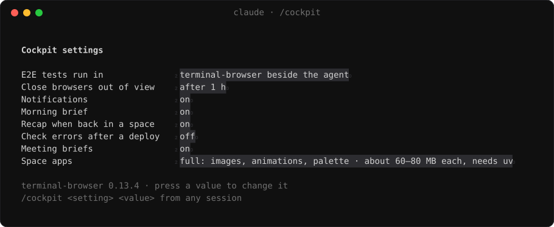

<p align="center"></p>

<h1 align="center">cockpit</h1>

<p align="center"><b>Run several Claude Code agents in <a href="https://herdr.dev">herdr</a> without losing track of them.</b><br>
One agent per space, pinned spaces for your inbox, to-dos, runbooks and meetings, and the right links in every session.</p>


## Install

In a Claude Code session inside herdr:

```
/plugin install cockpit --marketplace quaresc/cockpit
/cockpit:setup
```

Setup installs the herdr half, asks which features you want and writes your config. `/cockpit:doctor` checks
everything and says how to fix what is off. Updates arrive as a notification.

**Needs** macOS (Linux untested), herdr 0.9+, `gh` signed in, `jq`, Python 3, Xcode command line tools and a Nerd
Font.

## Features

<table>
<tr><td width="24%"><b>🧭 Sidebar</b></td><td>Counts on the pinned spaces; per agent its task, branch, ticket, CI and the page beside it. Red on failing CI or two agents on one branch.</td></tr>
<tr><td colspan="2" align="center"></td></tr>
<tr><td width="24%"><b>🔗 Footer</b></td><td>One click to the ticket, PR, deploy dashboard, preview and each page the conversation cites.</td></tr>
<tr><td colspan="2" align="center"></td></tr>
<tr><td width="24%"><b>📥 Inbox</b></td><td>Review requests, then your tickets by project with their stacked PRs, CI, deploys and previews. Each row has its actions.</td></tr>
<tr><td colspan="2" align="center"></td></tr>
<tr><td width="24%"><b>🧪 E2E tests</b></td><td>The agent opens its page in terminal-browser beside it, on phone and desktop, main against the branch, and puts the before/after in the PR.</td></tr>
<tr><td colspan="2" align="center"></td></tr>
<tr><td width="24%"><b>📋 Runbook</b></td><td><code>/runbook</code> writes the steps left to ship a ticket and keeps them current; steps light up as they get done.</td></tr>
<tr><td colspan="2" align="center"></td></tr>
<tr><td width="24%"><b>📊 Show</b></td><td>Charts, tables, flow charts, sequence diagrams, diffs, live Metabase or Datadog data and questions, in a pane beside the agent.</td></tr>
<tr><td colspan="2" align="center"></td></tr>
<tr><td width="24%"><b>🔔 Notifications</b></td><td>Each leads somewhere useful, with buttons that act: Review, Why?, Rerun, Plan, Join.</td></tr>
<tr><td colspan="2" align="center"></td></tr>
<tr><td width="24%"><b>☀️ Briefs</b></td><td>A morning brief, meeting briefs, a recap when you come back to a space, a check after each deploy.</td></tr>
<tr><td colspan="2" align="center"></td></tr>
<tr><td width="24%"><b>📝 To-do</b></td><td>A Markdown list; <code>/todo &lt;text&gt;</code> adds to it from any session, ticket keys and links clickable.</td></tr>
<tr><td colspan="2" align="center"></td></tr>
<tr><td width="24%"><b>📅 Meetings</b></td><td>Your week, with join and prepare on each meeting.</td></tr>
<tr><td colspan="2" align="center"></td></tr>
<tr><td width="24%"><b>⚙️ Settings</b></td><td><code>/cockpit</code> flips what you change day to day.</td></tr>
<tr><td colspan="2" align="center"></td></tr>
</table>

## Supported tools

**Built in** works with no mapping and is tested. **Mapped by setup**: `/cockpit:setup` reads that connector's tools and
writes which tool does what, so it works as far as the connector's tools go.

| Area | Built in | Mapped by setup |
| --- | --- | --- |
| Code, PRs and reviews | GitHub | |
| Tickets | Linear | Jira, Trello, Asana, ClickUp, Shortcut, GitHub Issues, GitLab Issues, Azure DevOps Boards |
| CI | GitHub Actions and every GitHub check on your PRs (CircleCI, Buildkite and Jenkins statuses included), CircleCI | GitLab CI, Buildkite, Jenkins |
| Calendar | Google Calendar | Outlook |
| Deploys and previews | | Argo CD, Vercel, Netlify, Render, Railway, Fly.io, Backstage |
| Live data in show panes | Metabase, Datadog | |
| Check after a deploy | Datadog | Grafana, Sentry |
| Meeting briefs read | Notion | Confluence, Google Docs |
| E2E browser | terminal-browser, Claude in Chrome | |
| Line comments on a diff | herdr-reviewr | |

**Footer links** recognised, one chip each:

| | |
| --- | --- |
| Code review | GitHub pull requests, GitLab merge requests, Bitbucket pull requests, Azure DevOps pull requests |
| Tickets | Linear, Jira, GitHub issues, GitLab issues, Azure DevOps work items, Trello, Asana, ClickUp, Shortcut |
| Design | Figma (design, FigJam, Slides, Make), Miro, Excalidraw |
| Docs | Notion, Confluence, Google Docs, Google Sheets, Google Slides, Google Forms, Coda, Loom |
| Chat | Slack, Microsoft Teams, Discord |
| Monitoring | Sentry, Datadog, Grafana, PagerDuty, incident.io |
| Analytics | Amplitude, Mixpanel, PostHog, Metabase |
| Deploys | Argo CD, Vercel, Netlify, Render, Railway, Fly.io dashboards, and your preview environments |

## Configuration

`~/.config/cockpit/config.json`, written by `/cockpit:setup` and re-read every 30 seconds. See
[`config.example.json`](config.example.json).

<details>
<summary><b>Keys</b></summary>

| Key | |
| --- | --- |
| `reposDir` | Where your checkouts live; new agent spaces start there. |
| `github.org` | Only list your PRs from this org. |
| `tickets` | Ticket connector: `server`, `keys` (ticket key prefixes such as `ENG`), `urlTemplate`, and for anything but Linear the mapping setup writes. |
| `ci` | CI: GitHub checks when `server` is empty, else a CI connector and its mapping. `imageJob`: the job that builds a preview's image. |
| `calendar` | Calendar connector: Google Calendar, or another and its mapping. |
| `platform` | Deploy and preview connector, and its mapping. |
| `metabase`, `datadog` | Connectors for live panes. |
| `brief`, `meetingBrief`, `recap`, `deployWatch` | When briefs, recaps and deploy checks run, and the tools they may use. |
| `e2eBrowser` | Where agents run E2E tests: `terminal-browser` (beside the agent) or `chrome` (Claude in Chrome). |
| `spaces` | Pinned spaces, in sidebar order. |

</details>

<details>
<summary><b>Shortcuts</b></summary>

`prefix+i` inbox, `prefix+t` terminal, `prefix+d` to-do, `prefix+u` runbook, `prefix+m` meetings, `prefix+f` the page
beside the agent in your browser. In the apps: `j`/`k` rows, `h`/`l` buttons, Enter, `R` refresh.

</details>

## How it works

`plugin/` is the Claude Code half: it fetches in your sessions, one at a time, into `~/.cache/cockpit`. `herdr/` is the
herdr half: the space apps read that cache, and their buttons leave requests the next session carries out. The
screenshots are the real apps on made-up data; [`docs/screenshots`](docs/screenshots) regenerates them.

## License

MIT
