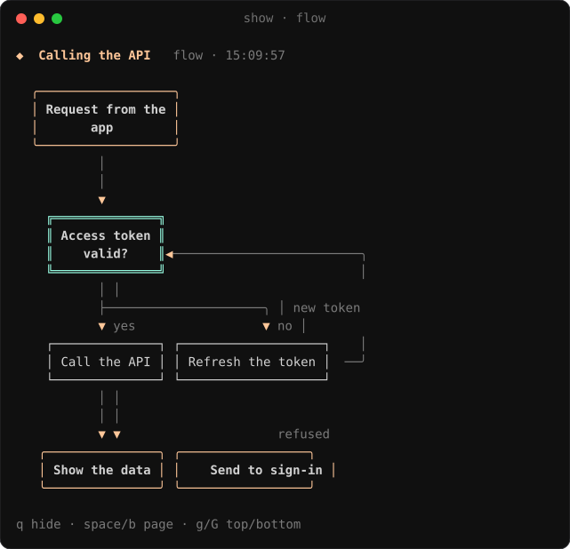
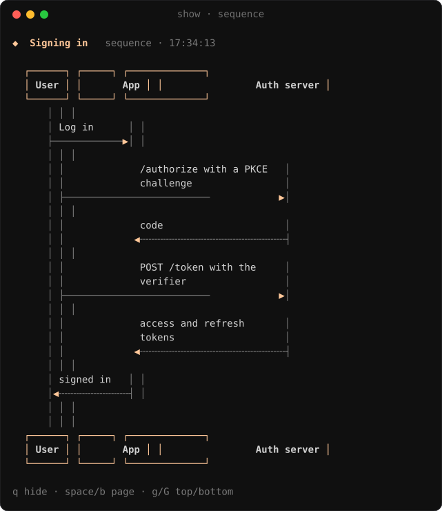
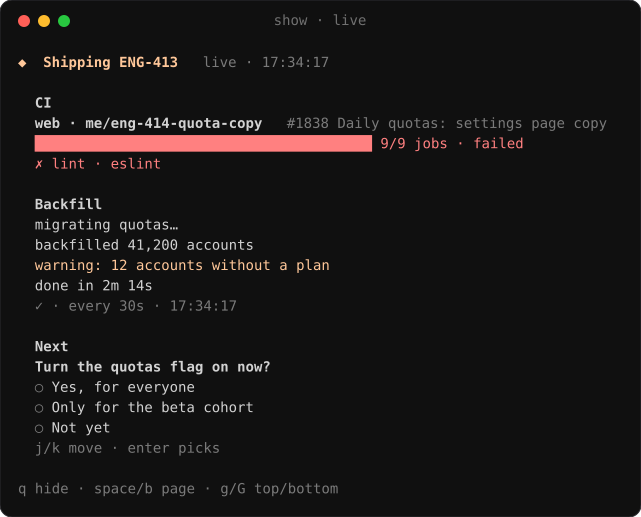
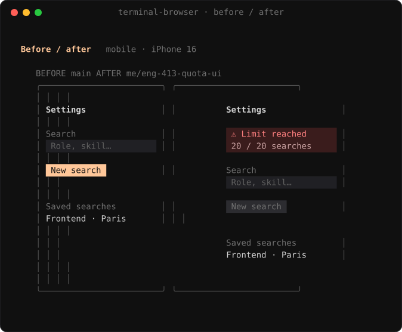

<p align="center"></p>

<h1 align="center">cockpit</h1>

<p align="center"><b>Run a handful of Claude Code agents in <a href="https://herdr.dev">herdr</a> without losing track of them.</b><br>
One agent per space, a few pinned spaces for everything around the code, and the right links in every session.</p>

<p align="center">
  <a href="#install">Install</a> ·
  <a href="#features">Features</a> ·
  <a href="#configuration">Configuration</a> ·
  <a href="#how-it-works">How it works</a>
</p>


> [!TIP]
> Only herdr and GitHub are required. `/cockpit:setup` asks about the rest, and `/cockpit:doctor` says how to fix
> whatever is off.

## Features

| | |
| --- | --- |
| 🧭 **Sidebar** | Every agent on one line: its task, the page beside it, its context use; under it the repo, ticket and CI. |
| 🔗 **Footer** | The ticket, PR, Figma, Notion, Slack, Argo and sandbox the conversation is about, one click each. |
| 📊 **Show** | Charts, tables, flow charts, sequence diagrams and diffs in a pane beside the agent, like an artifact. |
| 🧪 **Front checks** | The agent tests its change in a browser beside it, on phone, tablet and desktop, and keeps before/after screenshots for the PR. |
| 📥 **Inbox** | Review requests, then your tickets by project with their stacked PRs, CI, deploys and sandboxes. |
| 📋 **Runbook** | `/runbook` writes down what's left to ship a ticket, in order, and keeps it current. |
| 🔔 **Notifications** | macOS notifications that lead somewhere useful, with buttons that act: Review, Why?, Rerun, Plan, Join. |
| ☀️ **Briefs** | A morning brief, meeting briefs, a recap when you come back to a space, a check after each deploy. |
| ⚙️ **Settings** | `/cockpit` flips what you change day to day. |

### 🧭 Sidebar

Pinned spaces on top with their counts (reviews, CI, tickets, plan limits, to-dos, runbooks, the next meeting), then
one row per agent. When a page or a view sits beside an agent, its row splits like a browser's split view:
`quota-ui │ 🌐 Settings`, with `+N` for the other tabs. A row turns red when its PR fails CI, or when another agent is
on the same branch.

### 🔗 Footer

Each conversation's footer links what it works on: the ticket it names (else its branch's), the PR, the Figma frame,
the Notion page, the Slack thread, the Argo app and the sandbox. Links open in your default browser. A chip per view the
agent showed hides or brings back its pane, and the **browser** chip sends the page beside the agent to your default
browser.

### 📊 Show

Ask for a chart, a table, a diagram, a picture or a diff, and the agent draws it in a herdr pane beside the conversation
with cockpit's `show` tool. Asking again updates the same pane; `q` hides it to a footer chip that brings it back.


<details>
<summary><b>Flow charts, sequence diagrams, live blocks and diffs</b></summary>

A flow chart is nodes and edges: the pane lays them out, routes the arrows and runs loops around the side.



Exchanges between actors are sequence diagrams, as blocks or as Mermaid.



Some blocks keep themselves current: a chart or table fed by Metabase or Datadog refreshes while its pane is open, a
log tails a command, a CI block follows the branch's run. A question sends your answer back to the agent as your next
message. A block that runs a command asks for your approval first.



A repo diff follows the working tree as the agent edits. With [herdr-reviewr](https://github.com/persiyanov/herdr-reviewr),
its `reviewr` button opens the same changes for line comments that go back to the agent.


Wide tables, big diagrams, pictures and side-by-side diffs can open as a full-resolution page in the browser beside the
agent instead (`placement: "browser"`).

</details>

### 🧪 Front checks

With [terminal-browser](https://github.com/zenbu-labs/terminal-browser), the agent opens its dev server in a browser
pane beside the conversation and drives it while you watch: clicks, forms, screenshots, at iPhone, iPad and 1440 px
desktop sizes. The `side-browser` skill tells agents how, and when you say "this page", the agent knows which one you
mean. For a PR it takes the same screens on `main` and on its branch and shows them side by side:



The screenshots go into the PR description through GitHub's own editor, and you press Save.

> [!NOTE]
> Without terminal-browser, or with `/cockpit checks chrome`, front checks run in Claude in Chrome. A browser left
> beside an agent whose space stays out of view for an hour closes by itself.

> [!IMPORTANT]
> On macOS, browser panes scroll smoothly only with Ghostty's tip builds and terminal-browser at
> `render.transport auto` and `render.fps 60`. `/cockpit:setup` sets them and `/cockpit:doctor` checks them.

### 📥 Inbox

Hover a row (or use `j`/`k`) for its buttons: review, fix CI, rerun, continue, done.


A branch with a built image gets a `sandbox` button; a sandbox still running a merged branch gets `stop`.


### 📋 Runbook

Merges, deploys, migrations and prod commands, in order. `run` hands a step back to the session that wrote it, `done`
checks it off yourself. The session reports how the step went with cockpit's `report_step` tool; the outcome shows
under the step.


It refreshes in the background, and by itself when the ticket goes live. Steps that just got done light up:


### 🔔 Notifications

Each one leads somewhere useful when clicked, and its buttons act without opening anything: **Review** starts a
`/code-review` in a new space, **Why?** investigates failing CI, **Rerun** reruns its failed jobs, **Plan** picks up a
new ticket, **Join** opens the call, **ArgoCD** follows a fresh sandbox. herdr's own popups stay in-app, so nothing
arrives twice.


> [!TIP]
> Set Cockpit to **Alerts** in System Settings › Notifications to keep the buttons on screen; banners show them on hover.

### ☀️ Briefs and recap

- **Morning brief** at 8:30 on weekdays: meetings, reviews waiting, PRs failing or ready, overnight CI failures,
  tickets that moved.
- **Meeting briefs**: press `prepare` on a meeting and Claude reads the invite, its linked docs and tickets, and writes
  why it exists, where things stand and what to bring.
- **Recap**: come back to a space after a while and a popup tells you what the agent did.
- **After a deploy** (optional): half an hour after a ticket goes live, Claude checks errors and latency.


### 📝 To-do and meetings

A Markdown to-do list (`/todo <text>` from any session) and your calendar.


### ⚙️ Settings

`/cockpit` opens a pane where each value is a button; `/cockpit checks chrome` and the like set one from any session.


## Install

In a Claude Code session inside herdr:

```
/plugin install cockpit --marketplace quaresc/cockpit
```

Answer `y`, pick a scope, then run `/cockpit:setup`. It installs the herdr half, asks which features you want, writes
your config, merges its settings into herdr's config (diff first), and lists the permission rules to add. New versions
arrive as a notification: click it to update.

### Requirements

- macOS. Linux should work (`xdg-open`, `wl-copy` or `xclip`, `notify-send`) but is untested.
- herdr 0.9+, and Claude Code with plugin hooks modules
- `gh` signed in, `jq`, Python 3, and `swiftc` (Xcode command line tools) for notifications
- A Nerd Font: it's drawn with FiraCode Nerd Font Mono.
- Optional: Linear, CircleCI, Google Calendar, Platform, Datadog and Metabase connectors,
  [herdr-reviewr](https://github.com/persiyanov/herdr-reviewr) for line comments on a diff, and
  [terminal-browser](https://github.com/zenbu-labs/terminal-browser) for front checks beside the agent.

## Configuration

`~/.config/cockpit/config.json`, re-read every 30 seconds. See [`config.example.json`](config.example.json).

<details>
<summary><b>All keys</b></summary>

| Key | |
| --- | --- |
| `reposDir` | Where your checkouts live. New agent spaces start there. |
| `github.org` | Only list your PRs from this org. Empty for all. |
| `linear.teams` | Team keys to recognise in ticket mentions, on top of your tickets' own. |
| `<connector>.server` | The connector's name in `claude mcp list`. |
| `circleci.imageJob` | The job that builds the image a sandbox runs. Enables `sandbox` and `redeploy`. |
| `platform.*` | Deploys and sandboxes. Argo links come from the URL templates, new sandboxes from `sandboxDefaults`. |
| `brief` | When the morning brief comes, and whether on weekends. |
| `deployWatch` | The after-deploy check: how long to wait, and which read-only tools it may use. |
| `recap` | How long you need to be away before the recap shows. |
| `meetingBrief` | The model, titles that get no brief, and the read-only tools a brief may use. |
| `checksBrowser` | Where agents check front changes: `terminal` (the pane beside them) or `chrome` (Claude in Chrome). |
| `browserIdleMinutes` | Close a browser beside an agent whose space stayed out of view this long (60); `0` keeps it. |
| `metabase`, `datadog` | `server`: the connector's name in `claude mcp list`, for live panes. |
| `spaces` | Which pinned spaces exist, in sidebar order. |
| `runbookTools` | Extra tools the runbook refresh may use. |

</details>

<details>
<summary><b>Keys</b></summary>

`prefix+i` inbox, `prefix+t` terminal, `prefix+d` to-do, `prefix+u` runbook, `prefix+m` meetings, `prefix+f` the page
beside the focused agent in your default browser.

In the apps: `j`/`k` rows, `h`/`l` or Tab buttons, Enter to press, `R` to refresh, `g` to group tickets by project or
status. In a show pane: `q` hides it, Space and `b` page, `g`/`G` top and bottom, Enter folds a diff's file or answers a
question, `r` opens reviewr, `o` opens the page.

</details>

## How it works

```
plugin/   Claude Code plugin: the hooks module, the side-browser skill, /cockpit, /runbook, /todo, /inbox, setup, doctor
herdr/    herdr plugin: the space apps, show.py for the show panes, and the scripts herdr runs on events
```

Network calls happen in your Claude sessions, one at a time thanks to a lock, and land in `~/.cache/cockpit`. The herdr
apps only read those files. Their buttons leave requests that the next session checks against
`plugin/hooks/protocol.ts`, carries out and answers. The apps share one terminal layer, `herdr/view.py`. Your own lists
live in `~/.config/cockpit`.

Screenshots show the real apps on made-up data; [`docs/screenshots`](docs/screenshots) regenerates them.

## License

MIT
