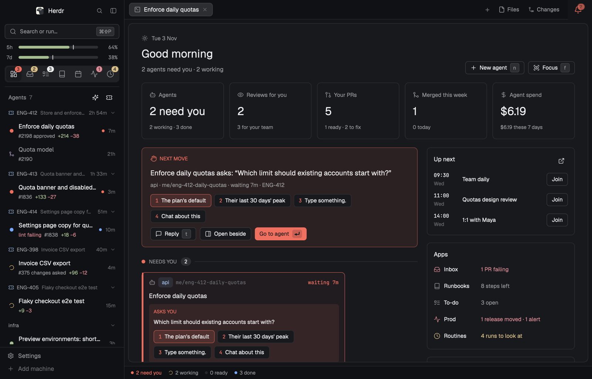

<p align="center"></p>

<h1 align="center">cockpit</h1>

<p align="center"><b>Every coding agent, beside its work.</b><br>
Claude Code, Codex and every other agent Herdr runs, each next to its ticket, PR, CI and deploy;<br>
Home tells you whose move it is, and your inbox, mail, runbooks, meetings and releases are one key away.</p>

<p align="center"><a href="https://quaresc.github.io/cockpit/#demo"><b>▶ Watch the 40-second demo</b></a> ·
<a href="https://quaresc.github.io/cockpit/">Website</a> ·
<a href="https://quaresc.github.io/cockpit/desktop.html">Herdr APP</a> ·
<a href="https://quaresc.github.io/cockpit/terminal.html">Herdr TUI</a> ·
<a href="https://github.com/quaresc/cockpit/releases">Changelog</a></p>

[](https://quaresc.github.io/cockpit/#demo)

## Install

In Claude Code:

```
/plugin install cockpit --marketplace quaresc/cockpit
/cockpit:setup
```

With any other agent (Codex, OpenCode, Pi, …), in a shell:

```sh
curl -fsSL https://raw.githubusercontent.com/quaresc/cockpit/main/install.sh | sh
cockpit setup
```

The shell install needs cockpit 0.33.0 or later.

Setup asks what you want and wires [herdr](https://herdr.dev), the Herdr app, or both; `cockpit doctor` checks
everything. Needs `gh` signed in and `jq`. Release binaries for macOS and Linux (x86_64, arm64); macOS notifications
use a small notifier app, Linux `notify-send`. What cockpit asks an agent to do (recaps, routines, meeting briefs)
runs on the agent you pick in setup.

## Update

cockpit tells you when a new version is out, with a notification you click to update. Any time, in a shell:

```sh
cockpit update
```

It updates every part you have (the Claude Code plugin, the herdr plugin and the binary, the Herdr app's layout and
mod, or a shell install), then restarts the apps and reloads idle Claude sessions. In Claude Code alone,
`/plugin update cockpit@cockpit` updates the plugin.

## Agents and tools

cockpit works with every agent Herdr runs: their status, questions answered from the sidebar, recaps, Home, the inbox,
mail, runbooks, meetings, routines, and the show, search and changes tools over MCP.

Tickets, pull requests, CI runs, meetings, mail, deploys and previews, and the release monitor come from MCP servers,
which cockpit calls itself, whatever your agent. `cockpit setup` finds the servers your agents already use (Codex's,
OpenCode's, Gemini's…), offers the ones it knows (Linear, Jira, GitHub Issues, GitLab, CircleCI, Datadog, Sentry, and Gmail and Google
Calendar through a Google OAuth client you create), logs cockpit in once through your browser, and has your agent map any other server's tools: any ticket tracker, code host,
CI, calendar, mail, deploy platform, or metrics and errors tool (Grafana, Prometheus, New Relic…) for the release
monitor and live chart panes. Every action goes through the same servers: moving, assigning and filing tickets, merging
pull requests, rerunning CI, previews, archiving mail. Agents read your tools through cockpit's `cockpit_read` and
`cockpit_health` tools, so meeting briefs and deploy checks work with any agent. In Claude Code, `/cockpit:setup` can use
its connectors instead.

A few parts read Claude Code itself: the quota bars and Agent spend, the footer under the prompt, the `/runbook` and
`/todo` commands, and the morning brief.

## Develop

[CONTRIBUTING.md](CONTRIBUTING.md) explains how the repo is laid out, how to build and test each half, and the GUI
sandbox. Security reports go through [SECURITY.md](SECURITY.md).

## License

MIT; third-party parts are listed in [THIRD_PARTY_NOTICES.md](THIRD_PARTY_NOTICES.md).
