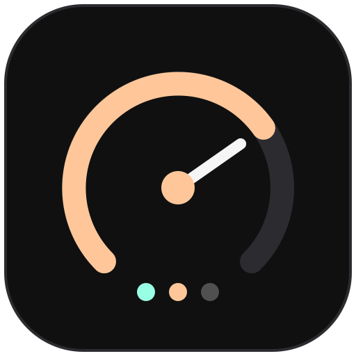

<p align="center"></p>

<h1 align="center">cockpit</h1>

<p align="center"><b>One space with everything, for Claude Code users who switch context all day.</b><br>
A Claude Code plugin and a <a href="https://herdr.dev">herdr</a> plugin that work as one.</p>

<p align="center"><b><a href="https://quaresc.github.io/cockpit/">quaresc.github.io/cockpit</a></b>: features,
shortcuts, configuration and changelog.</p>

herdr runs your agents side by side but doesn't know what they work on. cockpit adds that context: each agent sits
beside its **ticket, PR, CI, deploy** and the page it tests; pinned spaces hold your **inbox, runbooks, to-dos,
meetings, releases and routines**; **one palette** searches all of it, the week's history and your past sessions. It
also runs natively in the [Herdr desktop app](https://herdr.dev), on the same hub and data.



## Install

In a Claude Code session inside herdr:

```
/plugin install cockpit --marketplace quaresc/cockpit
/cockpit:setup
```

Setup installs the herdr half for your machine, asks which features you want and writes your config.
`/cockpit:doctor` checks everything and says how to fix it. Updates arrive as a notification. With the Herdr app
there, setup installs that half too (or run `cockpit app install`).

**Needs** macOS (Linux untested), herdr 0.9+, `gh` signed in, `jq`, Xcode command line tools and a Nerd Font.

**Everything else is on the site: [quaresc.github.io/cockpit](https://quaresc.github.io/cockpit/).**

## License

MIT
