<p align="center">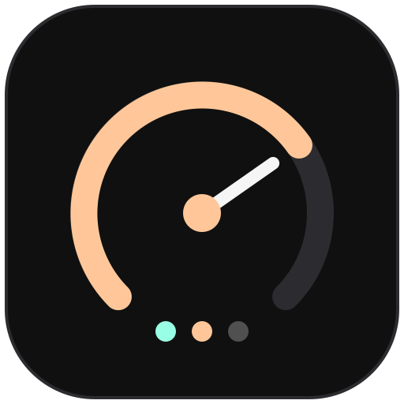</p>

<h1 align="center">cockpit</h1>

<p align="center">Run a handful of Claude Code agents in <a href="https://herdr.dev">herdr</a> without losing track of them.<br>
One agent per space, a few pinned spaces for everything around the code, and the right links in every session.</p>

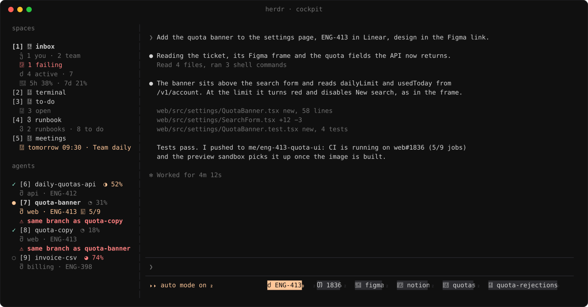

- **Sidebar.** Each agent shows its context use and the repo and ticket it's on. The line turns red when its PR fails
  CI, or when another agent is on the same branch. The inbox space shows reviews, CI, tickets and plan limits.
- **Footer.** Links to the ticket, PR, Figma, Notion, Slack thread, Argo and sandbox the conversation is about, plus
  a chip per view the agent showed: press it to hide or bring back that pane.
- **Show.** Ask an agent for a chart, a table or a diff and it opens in a pane beside the conversation, like an
  artifact: query results as line or bar charts, a repo's diff following the working tree.
- **Inbox.** Review requests, then your tickets by project with their stacked PRs, CI, deploys and sandboxes.
- **Runbook.** `/runbook` writes down what's left to ship a ticket and keeps it up to date.
- **To-do and meetings.** A Markdown to-do list (`/todo <text>` from any session) and your calendar.
- **Notifications** (macOS) that open the right thing: the PR's checks, the agent's space, the meeting, the runbook.
- **Meeting briefs.** Press `prepare` on a meeting and Claude reads the invite, its linked docs and tickets, and writes
  why it exists, where things stand and what to bring. Dailies don't get one.
- **Morning brief.** At 8:30 on weekdays: meetings, reviews waiting, PRs failing or ready, overnight CI failures,
  tickets that moved.
- **Recap.** Come back to a space after a while and a popup tells you what the agent did.
- **After a deploy** (optional). Half an hour after a ticket goes live, Claude checks errors and latency and tells you
  if anything moved.
- **Chrome per agent** (optional). An agent using Claude in Chrome gets its own window next to the terminal.

Only herdr and GitHub are required. `/cockpit:setup` asks about the rest.

### Inbox

Hover a row (or use `j`/`k`) for its buttons: review, fix CI, rerun, continue, done.


A branch with a built image gets a `sandbox` button. A sandbox still running a merged branch gets `stop`.

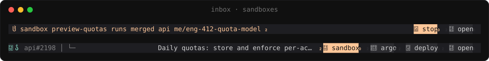

### Runbook

Merges, deploys, migrations and prod commands, in order. `run` hands a step back to the session that wrote it,
`done` checks it off yourself. The session reports how the step went with cockpit's `report_step` tool, which sets its
status; the outcome shows under the step, `session` jumps to it meanwhile, and a session that forgets is reminded once.

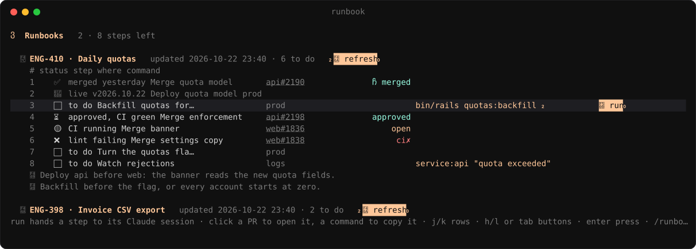

It refreshes in the background, and by itself when the ticket goes live. Steps that just got done light up:


### Show

Ask for a chart, a table or a diff, and the agent draws it in a herdr pane beside the conversation with cockpit's
`show` tool. Asking again updates the same pane. `q` hides it to a chip in the footer, and the chip brings it back.


A repo diff follows the working tree as the agent edits. With [herdr-reviewr](https://github.com/persiyanov/herdr-reviewr)
installed, its `reviewr` button opens the same changes for line comments that go back to the agent.

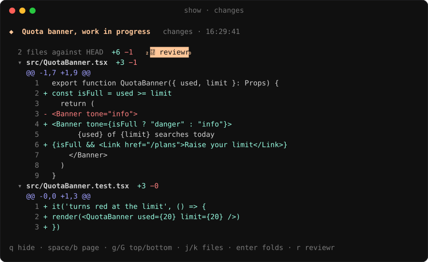

### Recap

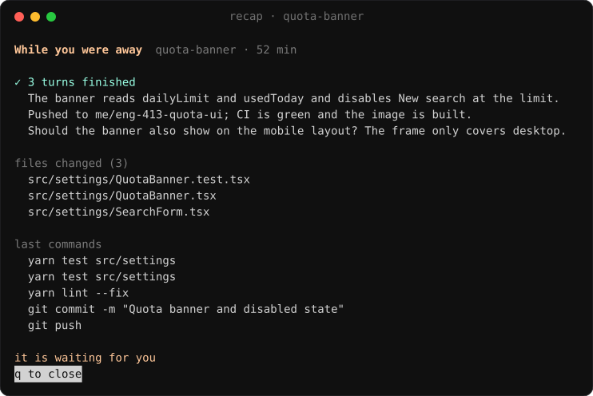

### Notifications

herdr's own popups stay in-app, so nothing arrives twice.


### To-do and meetings


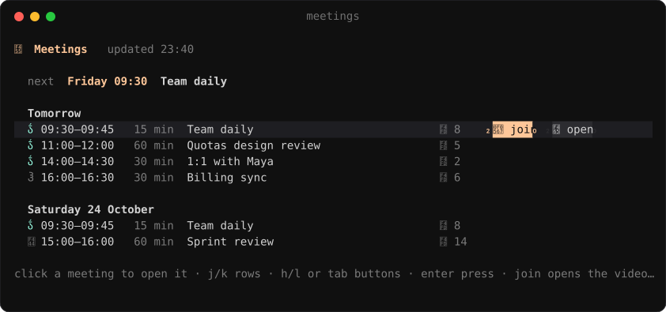

## Install

In a Claude Code session inside herdr:

```
/plugin install cockpit --marketplace quaresc/cockpit
```

Answer `y`, pick a scope, then run `/cockpit:setup`. It installs the herdr half, asks which features you want,
writes your config, merges its settings into herdr's config (diff first), and lists the permission rules to add.

Later, `/cockpit:doctor` checks everything and says how to fix what's broken. New versions arrive as a
notification: click it to update.

## Requirements

- macOS. Linux should work (`xdg-open`, `wl-copy` or `xclip`, `notify-send`) but is untested, and has no Chrome window.
- herdr 0.9+, and Claude Code with plugin hooks modules
- `gh` signed in, `jq`, Python 3, and `swiftc` (Xcode command line tools) for notifications
- A Nerd Font. It's drawn with FiraCode Nerd Font Mono.
- Optional connectors: Linear, CircleCI, Google Calendar, Backstage, Datadog, and herdr-reviewr for line comments on
  a diff

## How it works

```
plugin/   Claude Code plugin: the hooks module, and /runbook, /todo, /inbox, /cockpit:setup, /cockpit:doctor
herdr/    herdr plugin: the space apps, show.py for the show panes, and the scripts herdr runs on events
```

Network calls happen in your Claude sessions, one at a time thanks to a lock, and land in `~/.cache/cockpit`. The
herdr apps only read those files. Their buttons leave requests that the next session checks against
`plugin/hooks/protocol.ts`, carries out and answers. The apps share one terminal layer, `herdr/view.py`. Your own
lists live in `~/.config/cockpit`.

## Configuration

`~/.config/cockpit/config.json`, re-read every 30 seconds. See [`config.example.json`](config.example.json).

| Key | |
| --- | --- |
| `reposDir` | Where your checkouts live. New agent spaces start there. |
| `github.org` | Only list your PRs from this org. Empty for all. |
| `linear.teams` | Team keys to recognise in ticket mentions, on top of your tickets' own. |
| `<connector>.server` | The connector's name in `claude mcp list`. |
| `circleci.imageJob` | The job that builds the image a sandbox runs. Enables `sandbox` and `redeploy`. |
| `backstage.*` | Deploys and sandboxes. Argo links come from the URL templates, new sandboxes from `sandboxDefaults`. |
| `brief` | When the morning brief comes, and whether on weekends. |
| `deployWatch` | The after-deploy check: how long to wait, and which read-only tools it may use. |
| `recap` | How long you need to be away before the recap shows. |
| `meetingBrief` | The model, titles that get no brief, and the read-only tools a brief may use (e.g. Notion). |
| `chromeSideWindow` | One Chrome window per agent (macOS, iTerm2, Chrome). |
| `spaces` | Which pinned spaces exist, in sidebar order. |
| `runbookTools` | Extra tools the runbook refresh may use. |

## Keys

`prefix+i` inbox, `prefix+t` terminal, `prefix+d` to-do, `prefix+u` runbook, `prefix+m` meetings.

In the apps: `j`/`k` rows, `h`/`l` or Tab buttons, Enter to press, `R` to refresh, `g` to group tickets by project
or status. In a show pane: `q` hides it, Space and `b` page, `g`/`G` top and bottom, Enter folds a diff's file, `r`
opens reviewr.

Screenshots show the real apps on made-up data. [`docs/screenshots`](docs/screenshots) regenerates them.

## License

MIT
