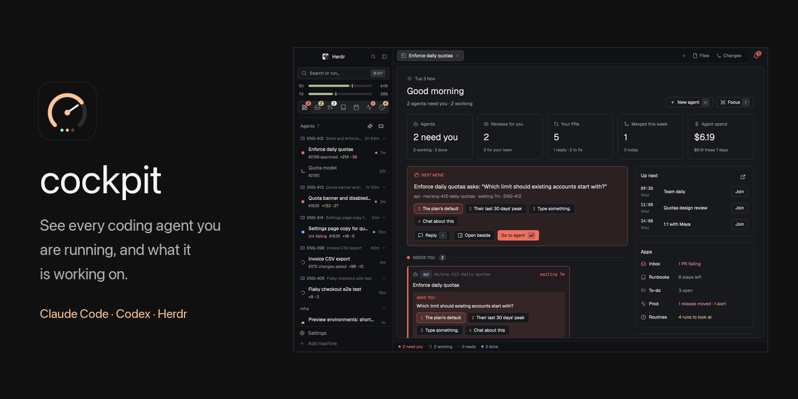
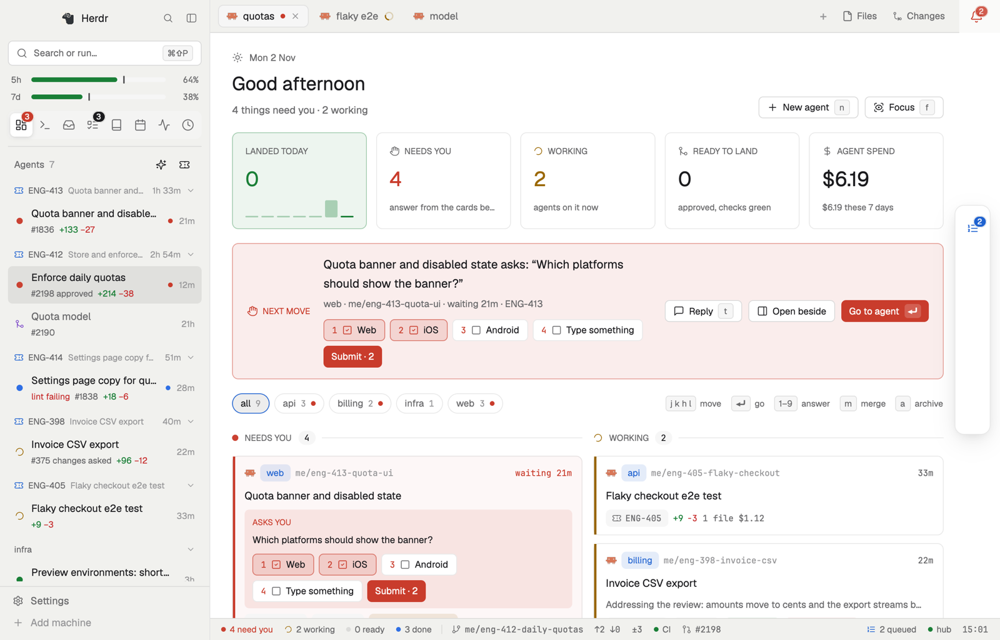

<!-- A copy of ../README.md, written by scripts/app-readme.sh: edit that one. -->

<p align="center"><a href="https://quaresc.github.io/cockpit/"></a></p>

<p align="center">See it running on the website: <a href="https://quaresc.github.io/cockpit/"><b>quaresc.github.io/cockpit</b></a></p>

<p align="center">Claude Code, Codex and the other agents Herdr runs, each shown with its ticket, pull request, CI run and
deploy, and which of them are waiting for an answer. Your reviews, mail, runbooks, meetings and releases are one key
away.</p>

<p align="center"><a href="https://quaresc.github.io/cockpit/desktop.html">Herdr app</a> ·
<a href="https://quaresc.github.io/cockpit/terminal.html">herdr in the terminal</a> ·
<a href="https://github.com/quaresc/cockpit/releases">Changelog</a></p>

<video src="https://raw.githubusercontent.com/quaresc/cockpit/main/docs/cockpit.mp4" controls muted
  poster="https://raw.githubusercontent.com/quaresc/cockpit/main/docs/app/home-dark.png" width="100%"></video>

<picture>
  <source media="(prefers-color-scheme: dark)" srcset="../docs/app/home-dark.png">
  
</picture>

## What you need

- macOS or Linux (x86_64 or arm64).
- [herdr](https://herdr.dev) 0.9 or later with a Nerd Font, the Herdr app, or both. cockpit runs inside one of
  them, so this is the one thing you cannot skip.
- `gh`, signed in, and `jq`.

Tickets, CI, meetings, mail and deploys come from MCP servers you already use, and are optional: the first setup
can leave them all out.

## Install

In Claude Code:

```
/plugin install cockpit --marketplace quaresc/cockpit
/cockpit:setup
```

With any other agent (Codex, OpenCode, Pi, …), in a shell:

```sh
curl -fsSL https://raw.githubusercontent.com/quaresc/cockpit/main/install.sh | sh
cockpit setup
```

Setup asks what you want and wires herdr, the Herdr app, or both; `cockpit doctor` checks everything afterwards.
macOS notifications use a small notifier app, Linux `notify-send`. What cockpit asks an agent to do (recaps,
routines, meeting briefs) runs on the agent you pick in setup.

In the Herdr app, cockpit is the layout and mod in [app/](../app/), which the Herdr gallery installs. They show
cockpit's data, so install cockpit as above too; until then, Home says how. [RECIPE.md](../app/RECIPE.md) describes the
layout pane by pane.

[Getting started](../docs/getting-started.md) walks through all of it, [configuration.md](../docs/configuration.md) lists
every setting, [show.md](../docs/show.md) the blocks an agent can draw, and [troubleshooting.md](../docs/troubleshooting.md)
what usually goes wrong.

## Questions

**Do I need API tokens?** No. cockpit reads what your agents already reach through MCP, and GitHub through `gh`.
Tokens are optional, and only make tickets, CI runs and meetings refresh without an agent session open.

**What does it cost?** cockpit is free and open source. The work it asks an agent to do (recaps, routines, meeting
briefs) is billed by whoever runs that agent; `routines` show what each run spent.

**Does it work without the Herdr app?** Yes, in herdr alone, and the other way round. Setup asks which you want.

**Is my data sent anywhere?** No. Everything stays on your machine: the hub talks to your agents, your MCP servers
and GitHub, and to nothing else.

## Update

cockpit tells you when a new version is out, with a notification you click to update. Any time, in a shell:

```sh
cockpit update
```

It updates every part you have (the Claude Code plugin, the herdr plugin and the binary, the Herdr app's layout and
mod, or a shell install), then restarts the apps and reloads idle Claude sessions. In Claude Code alone,
`/plugin update cockpit@cockpit` updates the plugin.

## Agents and tools

cockpit works with every agent Herdr runs: their status, questions answered from the sidebar, recaps, Home, the inbox,
mail, runbooks, meetings, routines, and the show, search and changes tools over MCP.

Tickets, pull requests, CI runs, meetings, mail, deploys and previews, and the release monitor come from MCP servers,
which cockpit calls itself, whatever your agent. `cockpit setup` finds the servers your agents already use (Codex's,
OpenCode's, Gemini's…), offers the ones it knows (Linear, Jira, GitHub Issues, GitLab, CircleCI, Datadog, Sentry, and Gmail and Google
Calendar through a Google OAuth client you create), logs cockpit in once through your browser, and has your agent map any other server's tools: any ticket tracker, code host,
CI, calendar, mail, deploy platform, or metrics and errors tool (Grafana, Prometheus, New Relic…) for the release
monitor and live chart panes. Every action goes through the same servers: moving, assigning and filing tickets, merging
pull requests, rerunning CI, previews, archiving mail. Agents read your tools through cockpit's `cockpit_read` and
`cockpit_health` tools, so meeting briefs and deploy checks work with any agent. In Claude Code, `/cockpit:setup` can use
its connectors instead.

Results are drawn in a pane beside the session with the `show` tool: stat tiles, line, area, bar and donut charts,
tables, flow, Mermaid and sequence diagrams, diffs and images. Because of that, the Claude Code plugin stops an agent
from opening a hand-made HTML page beside the session, or publishing a claude.ai artifact, when `show` could draw it
instead; the refusal says so. Ask for a page or a link in so many words and it goes ahead, or prefix the command with
`COCKPIT_SHOW_FALLBACK="<what show cannot draw>"`.

A few parts read Claude Code itself: the quota bars and Agent spend, the `/runbook` and `/todo` commands, and the
morning brief. Every agent's links (GitHub, Linear, CircleCI, Argo, Slack…) and documents sit in the Herdr app's status bar,
and first in herdr's palette over that agent. Claude Code's footer shows them too, except in the Herdr app
(`"footer": {"links": true}` in the config brings them back there).

## Develop

[CONTRIBUTING.md](../CONTRIBUTING.md) explains how the repo is laid out, how to build and test each half, and the GUI
sandbox. Security reports go through [SECURITY.md](../SECURITY.md).

## License

MIT; third-party parts are listed in [THIRD_PARTY_NOTICES.md](../THIRD_PARTY_NOTICES.md).
