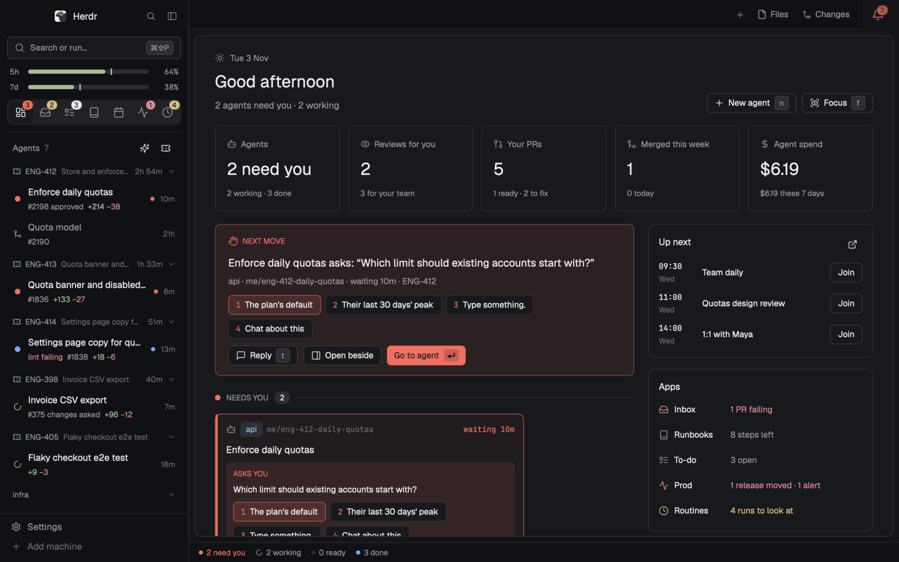

# Cockpit

See at a glance which of your coding agents needs you, and answer it without leaving what you're doing. Each agent
sits next to its ticket, PR and CI; your inbox, runbooks and meetings are one key away.

The preview shows the sidebar's agents list and Home's NEXT MOVE card, cropped from the real window on demo data.

Works with Claude Code, Codex and the other agents Herdr runs. The layout needs the
[cockpit](https://github.com/quaresc/cockpit) app for its data; without it, Home shows how to install it.

## What you see

Left to right, then top to bottom. Colors come from the person's Herdr theme (the dark values below are Herdr's default
dark theme); type is the theme's UI font at 13px, monospace for branches, refs and times.

- **Sidebar**, 268px wide (folds to a 44px rail), on the theme's `chrome` (`#101114` dark), not resizable:
  - **Brand**, 46px: Herdr's `workspace-chrome` (the Herdr mark, search, sidebar toggle), draggable.
  - **Cockpit sidebar**, the rest: a "Search or run…" field with its `⌘⇧P` hint; with Claude Code, two quota bars, 5h
    and 7d, each with its percent and a tick where the even pace would be (fill `#a6bd91`, track `#2c2e31`); a row of
    app icons, Home first, then the apps among the cockpit config's `spaces` in their order (Inbox, To-do, Runbook,
    Meetings, Monitor, Routines, Mail; without a config Home, Inbox, To-do, Runbook, Meetings), each with a count badge in a
    corner, the shown one on a raised tile; the **NEEDS YOU** band, on every view but Home (Home answers them itself):
    one card per agent waiting on you, three at most (a red-tinted card: its task, how long it has waited, its question
    and its choices as numbered rows or checkboxes, a Submit button, a reply arrow and a snooze alarm), then "N more
    waiting"; then **Agents** and their count, grouped by ticket ("ENG-412 Store and enforce… 2h 54m"), by space or by
    whose move (a button cycles), each agent a row with its status mark, title, PR number, `+adds −dels` and age; then
    Herdr's spaces list, each space followed by what runs in it, one line per terminal (status mark, agent or program,
    title; waiting ones first, four lines at most, then "+N more").
  - **Footer**, 69px: Herdr's `workspace-chrome` footer (Settings, Add machine).
- **Top bar**, 42px: Herdr's `tabs`, and at the right a 52px **bell**.
- **Center**, a stack with 8px padding; each view is a card with a 10px radius, a 1px `border` (`#2d2f32` dark), the
  `background` color and a small shadow. One is shown at a time:
  - **Home** (shown first): the date, "Good afternoon", one line of counts and New agent / Focus buttons; the tiles
    Agents ("2 need you"), Reviews for you, Your PRs, Merged this week, and Agent spend once Claude Code's plugin has
    written cost books; the **NEXT MOVE** callout (red-tinted, the longest-waiting agent's question with its choices as
    buttons, Reply, Open beside, Go to agent); the agents by stage as wrapped cards; your PRs no agent works on. On the
    right: Up next (meetings with Join), Apps (each app in a few words: "1 PR failing", "8 steps left", "Mail · 2 messages
    need you", a click opening its app) and Activity.
  - **Home without cockpit** (no `cockpit.json` in the Herdr home): a centered column, 620px at most: the cockpit mark
    (44px) beside "cockpit isn't installed" (18px, semibold) and a muted line; one line of what cockpit is; two cards,
    "In Claude Code" (`/plugin install cockpit --marketplace quaresc/cockpit`, `/cockpit:setup`) and "With any other
    agent, in a shell" (`curl -fsSL https://raw.githubusercontent.com/quaresc/cockpit/main/install.sh | sh`,
    `cockpit setup`), each command in monospace on a muted strip with a copy button; an outline Install guide button
    opening the README's install section, and a note that Home fills in by itself once setup is done.
  - **Work**: the active tab's panes (each with a 30px cockpit header: agent, folder, branch, status), or the focused
    agent alone with a 34px head. A hidden right **panel**, 420px (280–900): the agent's charts and diagrams (Show),
    its diff with line comments (Review), its runbook, Herdr's Files and Changes, and a 44px activity bar of their icons.
  - **Inbox, Runbook, To-do, Meetings, Monitor, Routines, Mail**: one full card each (PRs, reviews and tickets by
    feature; deploy steps with their commands; to-dos; the week's meetings; releases judged on errors and latency;
    scheduled agent runs and their output; mail).
  - **Mail**: messages in two groups, **Needs you** (from a person, or marked important) above **Updates** (bots,
    notifications, no-reply senders, newsletters), newest first; each row 52px: an 8px unread dot in `warning`, the
    sender (160px, in its person color while unread), the subject, the snippet under it, the age at the right; hovered
    or selected, a **See** button and archive / mark read icons. A double click or See opens the **reading panel** on the
    right (360–720px, 55% of the card; over the list as a sheet below 860px): the whole thread, each message under its
    avatar, sender, address and date, its HTML drawn natively (`TextView.html`, sanitized by the hub, links opening in
    the browser), plain text turned into paragraphs with clickable links; "Loading…" with skeleton lines while the
    thread is fetched, then "Waiting for a Claude Code session with the mail connector…" after 20 s; its footer Reply
    (an agent drafts it, nothing is sent), Archive, Mark read and Open in mail.
- **Status bar**, 28px: counts on the left ("2 need you · 2 working · 0 ready · 3 done", each a click), the focused
  agent's branch, ahead/behind, changed files, ticket, CI and PR on the right, queued prompts, agents to resume, and the
  hub's state only while it is offline.
- **Queue drawer**, floating on the right edge, centered, a 44px peek: prompts queued for an agent, shown only while
  some are.

## How it behaves

- **Agent status**, the same mark everywhere: working is a spinning ring in the theme's `working` color; blocked
  (needs you) is a dot in `blocked` (`#f0705f` dark) that breathes from 35% to full opacity every 1.2s; done is a solid
  dot in `done` (`#76a8ff`); idle is an empty ring in `idle`; merged a git-merge icon, snoozed an alarm clock.
- **Stages**, whose move it is: Needs you (blocked, or its PR to fix), Working, Ready to land (its PR approved and CI
  green), Done (done, idle, merged, snoozed, or in review and not ready). Home's columns and the status bar's counts
  use them.
- **Answering**: a number key or a click on a choice answers the card's agent in place (the hub reads its screen again
  and presses the keys); multi-choice ticks then Submit; the arrow opens a reply field; the alarm snoozes it (1h,
  18:00, tomorrow, till its status changes).
- **Home keys**: `j k h l` move between cards, `⏎` goes to the agent, `1–9` answer, `t` reply, `f` the agent beside
  the board, `m` merge, `a` archive (Undo on the toast), `o` PR, `r` recap, `s` snooze, `q` queue, `n` new agent;
  right-click for the rest. With no card picked, keys act on the NEXT MOVE agent.
- **Window keys** (`keys.json`, section `layout:cockpit`): `⌘⇧P` cockpit's palette (Herdr's commands plus PRs, tickets,
  runbooks, meetings, past sessions); `⌘⌥0` Home ↔ work; `⌘⌥1…7` Inbox, Runbook, To-do, Meetings, Monitor, Routines, Mail;
  `⌘⌥A` the focused agent alone; `⌘⌥B` the right panel, `⌃⌘1…5` its Show / Review / Runbook / Files / Changes;
  `⌘J` the next agent waiting, `⌘⇧J` the next blocked, `⌘⇧U` the next done; `⌘⌥Q` the queue; `⌘⌥R` resume agents
  lost to a restart; `⌘R` recap of every agent; `⌘G` the focused agent's PR; `⌘L` its ticket.
- **Bell**: while agents wait, a bell-dot icon in `blocked` with a red count that breathes from 70% to full every
  1.4s; when none waits but some finished, a plain bell with a 6px `done` dot. Click goes to the longest waiting, hover
  lists their questions, right-click picks one.
- **Notifications**: the hub's (CI failed, review asked, agent waiting, new mail) show as Herdr toasts while the window
  is in front, system notifications otherwise; a click lands on the row they are about (a new message opens in Mail's
  reading panel).
- **Mail keys**: `j k` move, `] [` between the groups, `⏎` See, `esc` closes the panel, `c` reply, `b` archive, `m` mark
  read, `o` open in the mail client, `⇧R` fetch now; right-click for the same.
- **Without the hub**: when cockpit isn't installed Home shows its install panel; whenever the hub doesn't answer the
  sidebar lists Herdr's own agents (status mark, title, click to focus) with no band, menu or recap, and the apps show
  "Cannot reach the cockpit hub" with the reason. Once `cockpit.json` appears every view connects by itself within
  seconds.
- Hover shows row actions; right-click opens a menu; drag a grip to reorder; toasts carry Undo instead of confirms.

## Built from

- **Layout** `layouts/cockpit.json` (preview art `layouts/cockpit.svg`): root `row` (`titlebar: none`, traffic lights
  at `[12, 16]`, `canvas` background, 1px `border` dividers, terminal padding `[14, 12]`) → `sidebar` column (px 268,
  min 44, max 480, `chrome`) of `brand` (`workspace-chrome`, 46) · `cockpit-sidebar` (`{app: "sidebar"}`, weight 1, min
  120) · `sidebar-footer` (`workspace-chrome {footer: true}`, 69); `main-area` column of `topbar` row (42: `tabs` ·
  `bell` 52) · `center` stack (padding 8, active `home`) · `status` (28). `center` holds `home` (row: `home-board` + a
  hidden `home-agent` column, 600px, of `agent-head {place: "home"}` 34 over `{agent: "focused"}`), `work` (row, gap 8:
  a `view` stack of `main` = `{tab: "active"}` with pane headers `{app: "pane"}` 30px, and `agent` = `agent-head` over
  the focused agent; then the hidden `panel` row, 420px: a `panel-body` stack of `show`, `review`, `runbook-panel`
  (`runbook {scope: "focused"}`), Herdr's `files` and `changes`, and `activity` 44px), then `inbox`, `runbook`,
  `todo`, `meetings`, `monitor`, `routines`, `mail` blocks. `floating`: `queue` (`{app: "queue"}`, edge right, align center,
  peek 44).
- **One mod** `mods/cockpit/` (`mod.json`: `place: none`, focusable): every block is the same mod with `props.app`
  (`sidebar`, `home`, `bell`, `status`, `pane`, `agent-head`, `activity`, `queue`, `show`, `review`, `runbook`, `inbox`,
  `todo`, `meetings`, `monitor`, `routines`, `mail`), and so is every overlay it opens (`palette`, `menu`, `recap`, `code`,
  `reader`, `kit`, `monitor-window`); `main.js` maps the name to a view class. `ui.js` is a shadcn-style kit on
  `theme()`; icons are lucide SVGs in `icons/`, the mark is `cockpit.svg`. Shipped mods used: `workspace-chrome`,
  `tabs`, `files`, `changes`, `menu` (a space's right-click) and `prompt` (the palette's Duplicate mod).
- **herdr functions**: `agents`, `terminals`, `spaces`, `panes`, `focused`, `layout`, `layouts`, `theme`, `settings`,
  `window` (the platform), `placement`, `props`, `home`, `appHome`, `knownAgents`, `setAgentOrder`,
  `shared`/`setShared`, `keys`, `commands`/`nextCommand`, `openOverlay`/`closeOverlay`, `notify`,
  `readTextFile`/`writeTextFile`, `watchFolder`, `exec`, `hc`, and `run` with `layout.select`, `layout.show`/`hide`,
  `agent.focus`, `space.select`/`new`/`rename`/`move`, `tab.new`/`select`/`settle`/`unsettle`,
  `pane.split`/`close`/`zoom`/`focus`, `terminal.peek` (the palette runs any command `commands()` lists).
- **Outside its folder**:
  - reads `cockpit.json` in the Herdr home (where `cockpit app install` put the binary and cache), the cache's
    `hub.json` and `config.json`, and `~/.config/cockpit/config.json` under the install's HOME;
  - opens a TCP connection to the hub on `127.0.0.1` (port and token from `hub.json`); nothing else reaches the
    network but `curl` fetching a show picture an agent gives by URL;
  - runs the `cockpit` binary (through `env`, on the install's HOME), `git` (a space's repo, the code view),
    `hc machine ls` (Open in editor on another machine), `~/.local/bin/herdr-app do pane.split` (the code view), the
    editor from the config's `editor` (`code`, `cursor`, `zed`, …; `code -g` from the code view; on macOS
    `open -a <app>` when its command isn't on the PATH), `open` on macOS, `xdg-open` on Linux and `cmd /c start` on
    Windows for links, and `sh -c` with `mkdir`, `curl` or `cp`, then `sips` (macOS) or `file` (elsewhere), to copy a
    show picture into `data/cockpit/show/` in the Herdr home and read its size;
  - reads and writes the repo file open in the code view, and reads the files the routines and the reader show.

## Watch out

- **It needs cockpit** for everything but the shell: copying `layouts/` and `mods/` alone gives the install panel on
  Home and Herdr's agents in the sidebar. Install cockpit first, either way:
  - in Claude Code: `/plugin install cockpit --marketplace quaresc/cockpit`, then `/cockpit:setup`;
  - any agent: `curl -fsSL https://raw.githubusercontent.com/quaresc/cockpit/main/install.sh | sh`, then
    `cockpit setup`.

  Setup runs `cockpit app install`, which copies this layout and mod into the Herdr home, writes `cockpit.json`,
  merges `keys.json` and switches to the layout once.
- **Claude Code only**: the quota bars and the Agent spend tile. The inbox requests (CI reruns, preview
  create/redeploy/stop/extend, marking a ticket Done) and Mail's (reading a thread, archiving, marking read) are carried
  out by the hub through the source's MCP server, or by a Claude Code session with its connectors; GitHub Actions reruns
  go through `gh`. **Monitor** needs a deploy-platform
  server and Datadog's; without them it says what to set.
- Answering in place parses the question screens cockpit knows (Claude Code's first): another agent's question may
  show as its status alone.
- Herdr refuses imports outside a mod's folder, hence one mod for every place and every overlay. Don't split it.
- The hub serves every view's model (`view`, pushed on `subscribe`) and runs every action (`act`); the JS only draws.
  When `cockpit.json` names a binary that's gone, the mod tries `cockpit hub start` once per 30s for all views.
- A window behind others does not repaint, so `herdr-app shot` returns its last frame: bring it to the front first.
- **Platforms**: built and tested on macOS; cockpit ships release binaries for macOS and Linux, none for Windows (there
  the window stays on the install panel). The keys are `cmd` keys: Herdr reads `cmd` as the platform key everywhere,
  which on Linux and Windows is the Super / Windows key that many desktops keep for themselves, and `keys.json` has no
  per-platform sections, so rebind them under `layout:cockpit` there. macOS only: the `open -a` editor fallback, and
  `sips` (elsewhere a picture's size comes from `file`; without it the picture is drawn at 800×500).

## Done when

- `herdr-app check mods/cockpit` passes.
- `layout.switch {"name": "cockpit"}` shows the sidebar, top bar with bell, Home and the status bar.
- Without `cockpit.json` in the Herdr home, Home shows "cockpit isn't installed" with both install commands, and an
  agent running in a Herdr terminal shows in the sidebar's Agents with its status.
- With cockpit installed and an agent waiting on a question, its card shows in NEEDS YOU (on any view but Home) and on
  Home's NEXT MOVE, the bell counts it, and pressing `1` on Home answers it (the agent moves on, the card goes).
- `⌘⌥1…7` switch the center to each app, `⌘⌥0` back to Home; `⌘⇧P` opens the palette and finds a PR by a word of its
  title.
- `⌘⌥B` opens the right panel beside the active tab; `⌃⌘2` shows the focused agent's diff.
